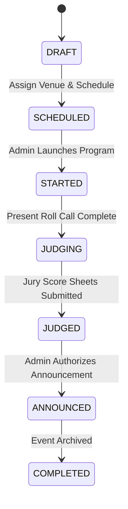

# Scoring Engine & Result Workflow Documentation

## 1. Multi-Judge Aggregation Engine (`src/features/judging/services/multiJudgeEngine.ts`)

The scoring engine supports 4 aggregation methods:
- **SUM**: `Sum(Judge_1 + Judge_2 + ... + Judge_N)`
- **AVERAGE**: `Mean(Judge_Scores)`
- **OLYMPIC_TRIMMED**: Discards the highest and lowest scores across 3+ judges and computes the average of remaining scores.
- **WEIGHTED_AVERAGE**: Applies criterion and judge weight coefficients.

## 2. Dynamic Position & Grade Assignment (`src/features/results/services/resultCalculationEngine.ts`)

- **Positions**: Fully configurable (1st -> 5 pts, 2nd -> 3 pts, 3rd -> 1 pt, or Gold/Silver/Bronze).
- **Grades**: Evaluated against participant percentage mark (Grade A -> 80-100%, Grade B -> 60-79.99%).
- **Total Points Awarded**: `Points_Awarded = Position_Points + Grade_Points`.
- **Tie-Breaking Rules**:
  - `CRITERION_PRIORITY`: Breaks ties based on highest primary criterion.
  - `SHARED_POSITION`: Assigns tied rank to both participants.

## 3. Result State Machine & Announcement Lifecycle

## 4. Immutable Result Snapshots
When an administrator triggers **"Announce Results"**:
1. Ranks and points are computed and locked.
2. A JSON snapshot is written to `snapshot_data` capturing student full name, house team, event name, category, division, and announcement timestamp.
3. Points are accumulated into the House Championship Standings.
4. The event becomes visible on public portals (`/programs/[id]`, `/results`, `/live`).
